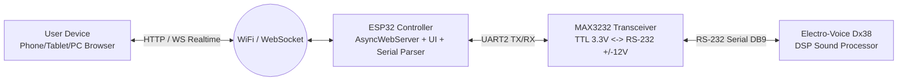

# Proyek ESP32 Web Server Remote Controller untuk Electro-Voice Dx38 / Dynacord DSP244

Rencana kerja (roadmap) ini memandu proses pembuatan modul pengganti software PC **RACE.exe** menjadi **Wireless Web Server berbasis ESP32**. Sistem ini memungkinkan kontrol penuh EV Dx38 (Mute, Master/Channel Gain, Preset Recall, Metering) dari browser smartphone, tablet, atau laptop tanpa memerlukan instalasi aplikasi tambahan.

---

## 1. Ikhtisar Arsitektur Sistem

---

## 2. Fase Pelaksanaan (Roadmap)

### Fase 1: Sniffing & Dekodifikasi Protokol RS-232
**Tujuan:** Mendapatkan struktur byte HEX perintah yang valid antara PC dan EV Dx38.

1. **Setup Monitoring Serial:**
   - Sambungkan PC ke port RS-232 Dx38 menggunakan adapter USB-to-Serial.
   - Pasang software Serial Monitor / Sniffer di PC (tampilan mode HEX).
   - Pastikan baudrate di panel depan Dx38 (menu *Utility*) dan RACE.exe cocok (default 19200 atau 38400 bps, 8-N-1).
2. **Pengambilan Data Log Perintah:**
   - **Handshake / Connect:** Byte yang dikirim saat `RACE.exe` melakukan *Going Online* atau *Netscan*.
   - **Mute / Unmute:** Rekam byte saat toggle tombol Mute untuk Output 1, 2, 3, 4 dan Master.
   - **Level / Gain Slider:** Rekam perubahan nilai Gain dari 0.0 dB, -0.5 dB, -1.0 dB, hingga -6.0 dB.
   - **Preset Recall:** Rekam perintah pemanggilan Preset (Preset 1, 2, dst.).
   - **Metering Stream:** Analisis apakah Dx38 mengirim stream level VU secara periodik atau berdasarkan polling.
3. **Analisis Struktur Frame Data:**
   - Mengidentifikasi:
     - Header / Start Byte (misal: `0xF0` MIDI SysEx atau `0x02` STX).
     - Target Device Address / ID.
     - Command Code (Opcode) & Sub-command (Channel ID).
     - Parameter Payload (Value bitmask atau integer 7-bit/8-bit/14-bit).
     - Checksum / End Byte (misal: `0xF7` EOX atau `0x03` ETX).

---

### Fase 2: Perancangan & Integrasi Hardware
**Tujuan:** Menghubungkan ESP32 dengan aman ke port serial Dx38.

1. **Komponen yang Disiapkan:**
   - ESP32 Development Board (ESP-WROOM-32 / NodeMCU-32S).
   - Modul RS-232 to TTL Transceiver dengan chip **MAX3232** (wajib chip 3.3V).
   - Konektor DB9 Female (pinout standard RS-232 DCE/DTE).
   - Power supply DC 5V (2A) untuk ESP32.
2. **Skema Pengkabelan (Wiring):**
   - `ESP32 3V3` ➔ `MAX3232 VCC`
   - `ESP32 GND` ➔ `MAX3232 GND`
   - `ESP32 GPIO 17 (TX2)` ➔ `MAX3232 RXD (TTL)`
   - `ESP32 GPIO 16 (RX2)` ➔ `MAX3232 TXD (TTL)`
   - `MAX3232 DB9 Connector` ➔ `Dx38 RS-232 Port` (Pin 2, Pin 3, Pin 5 GND).

---

### Fase 3: Pengembangan Firmware ESP32 (Backend)
**Tujuan:** Membangun core sistem web server dan driver komunikasi serial.

1. **Komponen Firmware:**
   - **Network Manager:**
     - Mode Dual: **Access Point (AP)** langsung (SSID: `EV-Dx38-Remote`, tanpa butuh router luar) dan **Station (STA)** untuk koneksi ke WiFi venue/FOH.
     - Layanan **mDNS** (`http://dx38.local`) agar mudah diakses tanpa mengetik IP.
   - **Asynchronous Web Server & WebSocket:**
     - Menggunakan `ESPAsyncWebServer` + `AsyncTCP`.
     - Komunikasi dua arah via **WebSocket** (latensi rendah <15ms) untuk pergerakan slider fader dan feedback VU meter.
   - **Serial Driver & Protocol Engine:**
     - Penanganan `HardwareSerial(2)` untuk pengiriman paket hex non-blocking.
     - Ring buffer parser untuk membaca feedback status dari Dx38.

---

### Fase 4: Desain & Pembuatan Antarmuka Web (Frontend)
**Tujuan:** Menghadirkan UI web modern, responsif, dan siap panggung (touch-friendly).

1. **Desain Sistem & Estetika (Pro Audio Dark Mode):**
   - Warna dasar dark slate/charcoal dengan aksen LED amber/green/red khas peralatan rack DSP.
   - Tipografi sans-serif modern, kontras tinggi dan mudah dibaca di pencahayaan redup (FOH / stage).
2. **Fitur Antarmuka:**
   - **Channel Strips (Out 1 - 4):**
     - Tombol Mute besar (dengan indikator status warna merah saat menyala).
     - Slider Gain presisi (range: -inf s.d. +6 dB / +12 dB) dengan tampilan nilai angka real-time.
     - Indikator Limiter / Compressor aktif.
   - **Master Section:**
     - Master Mute All.
     - Master Output Gain offset.
   - **Preset Manager:**
     - Dropdown / grid tombol untuk memanggil preset (1 s.d. 30).
     - Label nama preset yang sedang aktif.
   - **Connection Monitor:**
     - Indikator heartbeat status online/offline antara ESP32 dan unit Dx38.

---

### Fase 5: Pengujian, Kalibrasi & Finishing
1. **Pengujian Responsifitas:**
   - Verifikasi latensi gerakan fader di layar browser terhadap perubahan suara aktual pada speaker/DSP.
2. **Uji Stabilitas Jangka Panjang:**
   - Memastikan koneksi WebSocket tetap tersambung tanpa reconnect loop selama berjam-jam pemakaian.
3. **Penyimpanan Nilai Status (State Caching):**
   - ESP32 menyimpan status terkini di memori sehingga saat perangkat HP baru membuka browser, posisi fader dan mute langsung sinkron otomatis.
